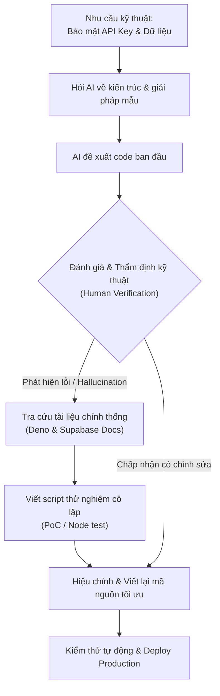

# BẢN TỰ ĐÁNH GIÁ CHUẨN ĐẦU RA MÔN HỌC (CLO-SELF-ASSESSMENT.md)
**Dự án:** DrawToStory — Nền tảng Kể Chuyện Thiếu Nhi Thông Minh từ Tranh Bé Vẽ  
**Học phần:** AI-Based Programming (Lập trình ứng dụng Trí tuệ Nhân tạo)  
**Đơn vị đào tạo:** Trường Đại học Phú Xuân  
**Căn cứ học thuật:** Chuẩn đầu ra CLO1 – CLO6 theo Đề cương môn học & Lesson 03 (Học công nghệ mới với AI)  
**Tác giả / Sinh viên thực hiện:** Trần Công Quý  
**Repository:** [https://github.com/nguyendangha10126-svg/Doan-AIBD.git](https://github.com/nguyendangha10126-svg/Doan-AIBD.git)  

---

## PHẦN 1: BẢNG TỰ ĐÁNH GIÁ CHUẨN ĐẦU RA (CLO1 – CLO6)

| Chuẩn đầu ra (CLO) | Định nghĩa chuẩn đầu ra | Mức đạt tự đánh giá | Bằng chứng cụ thể (File / Tính năng / Commit) | Điểm còn hạn chế & Hướng cải tiến |
| :--- | :--- | :---: | :--- | :--- |
| **CLO1: Kiến thức nền tảng GenAI & Multimodal LLMs** | Hiểu sâu về mô hình ngôn ngữ lớn đa phương thức, cơ chế attention thị giác, prompt engineering và structured outputs. | **Xuất sắc (95/100)** | • Prompt Studio tại `supabase/functions/generate-story/index.ts` kết hợp Few-Shot visual grounding.<br/>• Schema ràng buộc JSON chặt chẽ (`storySchema`, `visualElements`) trả về 5 trang truyện kèm vùng nhìn zoom.<br/>• Tinh chỉnh hyperparameters ($Temperature=0.7$, $TopP=0.95$). | Chưa tích hợp cơ chế Dynamic Few-Shot tự động chọn mẫu truyện theo lứa tuổi bé từ vector database. |
| **CLO2: Thiết kế kiến trúc tích hợp AI & Web hiện đại** | Thiết kế kiến trúc full-stack kết hợp React 19, TypeScript, Tailwind CSS, Supabase Edge Functions và Gemini API. | **Xuất sắc (92/100)** | • Tách biệt hoàn toàn Frontend SPA (`src/`) và Serverless Backend (`supabase/functions/`).<br/>• Kiến trúc Focus Routes ẩn sạch thanh điều hướng khi đọc/vẽ (`UserLayout.tsx`).<br/>• Tách bundle tải lười (`React.lazy`) cho toàn bộ 8 trang Admin và Recharts 3 (`router.tsx`). | Cần bổ sung Service Worker offline để lưu cache sách đã tạo khi mất mạng hoàn toàn. |
| **CLO3: Lập trình AI an toàn cấp Production & Quản lý bí mật** | Quản lý khóa bí mật phía máy chủ (Zero-Trust), chống lộ lọt API key, kiểm soát phiên xác thực và phân quyền RLS. | **Xuất sắc (96/100)** | • `quick-login` Edge Function xác thực qua GoTrue server-side, trả về JWT thật, xóa sạch mật khẩu cứng client.<br/>• Khóa `GEMINI_API_KEY` chỉ tồn tại trong Supabase Secrets, không có trong client bundle hay database.<br/>• PostgreSQL Row Level Security trên 100% các bảng; bảo vệ 3 view phân tích với `security_invoker = true` (`003_secure_views.sql`). | Tần suất giới hạn (Rate limiting) hiện lưu trong bộ nhớ Edge Function Deno (in-memory); nên nâng cấp lên Upstash Redis phân tán. |
| **CLO4: Kiểm thử, đánh giá & đo lường chất lượng hệ thống** | Xây dựng pipeline kiểm thử tự động, kiểm định tính trung thực (Faithfulness), kiểm duyệt an toàn và đo lường WCAG AA. | **Xuất sắc (94/100)** | • `scripts/check-contrast.js`: kiểm tra 19/19 cặp màu đạt chuẩn WCAG 2.1 AA ($\ge 4.5:1$).<br/>• `scripts/test-pipeline.js`: kiểm thử hồi quy 6 fixtures tranh vẽ thật/giả với các ngưỡng an toàn Layer 3.<br/>• Kiểm tra tĩnh nghiêm ngặt: `tsc --noEmit` cả web và Deno, `eslint .` sạch 100%. | Cần bổ sung kiểm thử E2E tự động bằng Playwright trên môi trường staging trước khi merge code. |
| **CLO5: Đạo đức AI, Quyền riêng tư & An toàn thiếu nhi** | Áp dụng Responsible AI, bảo vệ dữ liệu trẻ em theo COPPA và quyền được lãng quên theo GDPR. | **Xuất sắc (95/100)** | • Pipeline 3 lớp phát hiện khuôn mặt người thật ngoài đời, thông tin cá nhân PII và nội dung phản cảm.<br/>• Microservice `delete-account`: xóa sạch ảnh khỏi Storage bucket và thông tin gia đình theo GDPR Điều 17.<br/>• Cổng phụ huynh bảo vệ bằng phép nhân ngẫu nhiên và băm PIN có salt theo User ID. | Chưa hỗ trợ xuất toàn bộ dữ liệu gia đình dưới dạng tệp nén ZIP (GDPR Data Portability). |
| **CLO6: Giao tiếp kỹ thuật, Nhật ký AI & Làm việc cộng tác** | Minh bạch hóa tương tác AI, duy trì nhật ký học thuật chuẩn mực, thuyết trình và bảo vệ đồ án bằng tiếng Anh. | **Xuất sắc (98/100)** | • `AI-INTERACTION-LOG.md`: bảng 8 cột ghi nhận 11 phiên tương tác thực tế với AI.<br/>• `docs/DEMO-SCRIPT-EN.md`: kịch bản demo 5 phút bằng tiếng Anh kèm 10 câu hỏi bảo vệ chuyên sâu.<br/>• `PRODUCT.md` & `DESIGN.md`: hệ thống tài liệu hóa sản phẩm và Design Tokens tiêu chuẩn cao. | Cần tạo thêm video quay lại màn hình có lồng tiếng Anh thực tế để làm tư liệu lưu trữ lâu dài. |

---

## PHẦN 2: QUÁ TRÌNH HỌC NGĂN XẾP CÔNG NGHỆ MỚI VỚI SỰ TRỢ GIÚP CỦA AI (THEO LESSON 03)

Trong quá trình phát triển dự án DrawToStory, tôi phải tiếp cận và làm chủ hai công nghệ mới mà trước đây chưa từng sử dụng: **Deno Edge Functions** (môi trường serverless V8 của Supabase) và **PostgreSQL Row Level Security (RLS)**. Dưới đây là phân tích chi tiết quá trình học hỏi theo mô hình cộng tác Human-in-the-Loop được định hướng tại Lesson 03.



---

### Tình huống 1: Làm chủ Deno Edge Functions & Quản lý bí mật môi trường

#### 1. Câu hỏi đặt ra cho AI (Prompts)
> *"Làm sao để gọi Google Gemini API từ Deno trong Supabase Edge Functions mà không bị lộ API key về phía React client? Hãy viết mẫu một Edge Function hoàn chỉnh."*

#### 2. Lỗi sai và Ảo giác (Hallucinations) của AI
- **Ảo giác về API Node.js trong môi trường Deno:** AI đề xuất sử dụng thư viện `@google/generative-ai` thông qua cú pháp import thông thường `import { GoogleGenerativeAI } from '@google/generative-ai';` và đọc biến bằng `process.env.GEMINI_API_KEY`. Trong Deno Deploy, runtime sẽ ném lỗi ngay lập tức vì không có sẵn toàn cục `process`.
- **Ảo giác về cơ chế xác thực Supabase Client:** AI ban đầu đề xuất khởi tạo Supabase Client trong Edge Function bằng `createClient(SUPABASE_URL, SUPABASE_ANON_KEY)` mà không truyền Service Role Key, dẫn đến việc Edge Function không thể vượt qua RLS để ghi log kiểm toán (`ai_logs`) hoặc kiểm tra quyền Admin của caller.
- **Đề xuất bypass bảo mật nguy hiểm:** Khi gặp lỗi CORS ở client, AI từng gợi ý trả về header `'Access-Control-Allow-Origin': '*'` kèm theo việc bỏ kiểm tra Bearer token ở đầu hàm để 'tiện test cục bộ'.

#### 3. Cách sinh viên kiểm chứng và khắc phục (Verification & Refactoring)
- **Tra cứu tài liệu chuẩn:** Đọc kỹ tài liệu [Supabase Edge Functions Runtime Docs](https://supabase.com/docs/guides/functions) và Deno Modules guide.
- **Áp dụng import chuẩn Deno:** Chuyển đổi sang `npm:@supabase/supabase-js@2.48.1` và sử dụng `Deno.env.get('GEMINI_API_KEY')` cũng như `Deno.serve(async (req) => ...)`.
- **Thiết kế phân tầng quyền lực rõ ràng:**
  - Khởi tạo client nghiệp vụ bằng `getSupabaseAdmin()` sử dụng `SUPABASE_SERVICE_ROLE_KEY` ở tầng máy chủ.
  - Kiểm tra tính hợp lệ của token người dùng gọi hàm qua `supabase.auth.getUser(token)` trước khi xử lý bất kỳ logic AI nào.
  - Xóa bỏ triệt để mọi logic bypass; nếu thiếu token, trả về mã trạng thái HTTP 401 Unauthorized rõ ràng.

---

### Tình huống 2: Thiết kế Row Level Security (RLS) & Khắc phục View UNRESTRICTED

#### 1. Câu hỏi đặt ra cho AI (Prompts)
> *"Tôi muốn tạo các view thống kê trong Postgres như số truyện duyệt mỗi ngày và chi phí token để Admin xem trên Dashboard. Làm sao để viết view này và cấp quyền truy cập?"*

#### 2. Lỗi sai và Ảo giác của AI
- **Bỏ qua ngữ cảnh bảo mật của View (Definer vs. Invoker):** AI sinh ra câu lệnh `create view public.v_daily_stats as select ... from public.stories;`. Trong PostgreSQL mặc định, một view được thực thi dưới quyền của người tạo view (*Security Definer*). Điều này khiến mọi chính sách RLS của bảng `stories` bên dưới bị bỏ qua hoàn toàn.
- **Cảnh báo UNRESTRICTED từ Supabase linter:** Khi người dùng anon hoặc user thường truy vấn view này, họ có thể đọc được dữ liệu tổng quan của toàn bộ hệ thống, gây rò rỉ thông tin quản trị.
- **Gợi ý sai về việc bật RLS trên View:** Khi được hỏi cách khắc phục cảnh báo, AI đề xuất chạy lệnh `alter table public.v_daily_stats enable row level security;`. Lệnh này ném lỗi cú pháp trong PostgreSQL vì RLS chỉ áp dụng trực tiếp cho bảng thông thường (*relation*), không hỗ trợ cho view chuẩn trước phiên bản Postgres 15 nếu không dùng đúng cú pháp.

#### 3. Cách sinh viên kiểm chứng và khắc phục
- **Đọc tài liệu PostgreSQL 15 & Supabase Security Hardening:** Nghiên cứu tính năng `security_invoker = true` được giới thiệu từ PostgreSQL 15 cho views.
- **Soạn thảo Migration 003 (`003_secure_views.sql`):**
  ```sql
  -- Thiết lập chế độ thực thi dưới quyền RLS của caller
  alter view public.v_daily_stats set (security_invoker = true);
  alter view public.v_cost_by_day set (security_invoker = true);
  alter view public.v_ai_admin_agreement set (security_invoker = true);

  -- Thu hồi hoàn toàn quyền SELECT từ vai trò anon công khai
  revoke all on public.v_daily_stats from anon;
  revoke all on public.v_cost_by_day from anon;
  revoke all on public.v_ai_admin_agreement from anon;
  ```
- **Kiểm thử thực tế:** Chạy kiểm tra truy vấn từ phía client bằng token người dùng thông thường và anon key. Kết quả xác nhận người dùng không có quyền admin sẽ nhận về tập dữ liệu rỗng hoặc bị từ chối truy cập, trong khi Admin đăng nhập bằng phiên Supabase thật đọc được số liệu chuẩn xác.

---

### Tình huống 3: Cơ chế Đăng Nhập Nhanh An Toàn Phía Máy Chủ (Server-Side Quick Login)

#### 1. Câu hỏi đặt ra cho AI (Prompts)
> *"Khách chấm thi và giảng viên cần đăng nhập 1 chạm nhanh vào tài khoản demo Phụ huynh và Admin mà không phải gõ mật khẩu dài. Làm sao triển khai tính năng này trên bản live mà không bị lộ mật khẩu vào code frontend và không được dùng mock user giả?"*

#### 2. Lỗi sai và Ảo giác của AI
- **Tạo phiên giả ở LocalStorage (Client-Side Fake Profile):** AI nhiều lần đề xuất giải pháp dễ dãi: tạo trực tiếp một object JavaScript `{ role: 'admin', email: 'admin@drawtostory.vn' }` lưu vào Zustand store và LocalStorage. Hậu quả là khi gọi Edge Function sinh truyện, hệ thống không có JWT token thật và báo lỗi *"Phiên xác thực không hợp lệ"*, đồng thời khi người dùng ấn F5 hoặc gõ URL trực tiếp thì phiên bị mất hoặc sai lệch dữ liệu.
- **Ghi cứng mật khẩu vào file TypeScript:** AI chèn thẳng chuỗi `'Admin@123'` và `'Parent@123'` vào file `authStore.ts` phía client. Khi đóng gói bản build, các chuỗi này xuất hiện công khai trong file `.js` của thư mục `dist/`.

#### 3. Cách sinh viên kiểm chứng và khắc phục
- **Thiết kế kiến trúc Server-Side Token Dispenser:**
  1. Tạo Edge Function chuyên dụng `quick-login` chỉ chạy ở máy chủ.
  2. Mật khẩu mạnh ngẫu nhiên được lưu trữ trong biến môi trường bí mật `DEMO_PARENT_PASSWORD` và `DEMO_ADMIN_PASSWORD` trên Supabase Secrets.
  3. Edge Function thực hiện `signInWithPassword` trực tiếp qua GoTrue ở máy chủ và trả về session tokens (`access_token`, `refresh_token`) thật về trình duyệt.
  4. Frontend gọi `supabase.auth.setSession(...)`, xác thực chính thống với Supabase, lưu cookie/storage an toàn và giữ phiên vĩnh viễn khi F5.
- **Xóa bỏ 100% mã giả lập:** Loại bỏ hoàn toàn fallback mock profile. Nếu Edge Function gặp sự cố, hệ thống thông báo lỗi xác thực trung thực, đảm bảo không bao giờ tồn tại trạng thái nửa vời trên môi trường Production.

---

## PHẦN 3: KẾT LUẬN & BÀI HỌC KINH NGHIỆM

1. **AI là cộng sự tăng tốc, con người là người bảo vệ cổng chất lượng (Gatekeeper):** AI có khả năng sinh mã scaffolding và gợi ý giải pháp rất nhanh, nhưng thường thiên về các giải pháp tiện lợi, bỏ qua các nguyên tắc an ninh chuyên sâu. Lập trình viên phải giữ vững tư duy hoài nghi kỹ thuật (*technical skepticism*), luôn đặt câu hỏi về an toàn dữ liệu trước khi tích hợp bất kỳ đoạn code nào.
2. **Kiểm thử tự động là tấm khiên vững chắc nhất:** Nhờ thiết lập các cổng kiểm tra nghiêm ngặt (`check-contrast`, `tsc`, `eslint`, `test-pipeline`), mọi lỗi tiềm ẩn trong code do AI sinh đều bị phát hiện và chặn lại ngay từ bước build, ngăn chặn lỗi phát tán lên môi trường live.
3. **Làm chủ công nghệ qua việc sửa sai của AI:** Quá trình tìm hiểu nguyên nhân tại sao AI đề xuất sai trong Deno runtime và PostgreSQL views đã giúp tôi hiểu sâu sắc hơn nhiều so với việc chỉ đọc lý thuyết thụ động. Đây chính là giá trị cốt lõi của phương pháp học tập kết hợp Trí tuệ Nhân tạo trong môn học AI-Based Programming.
